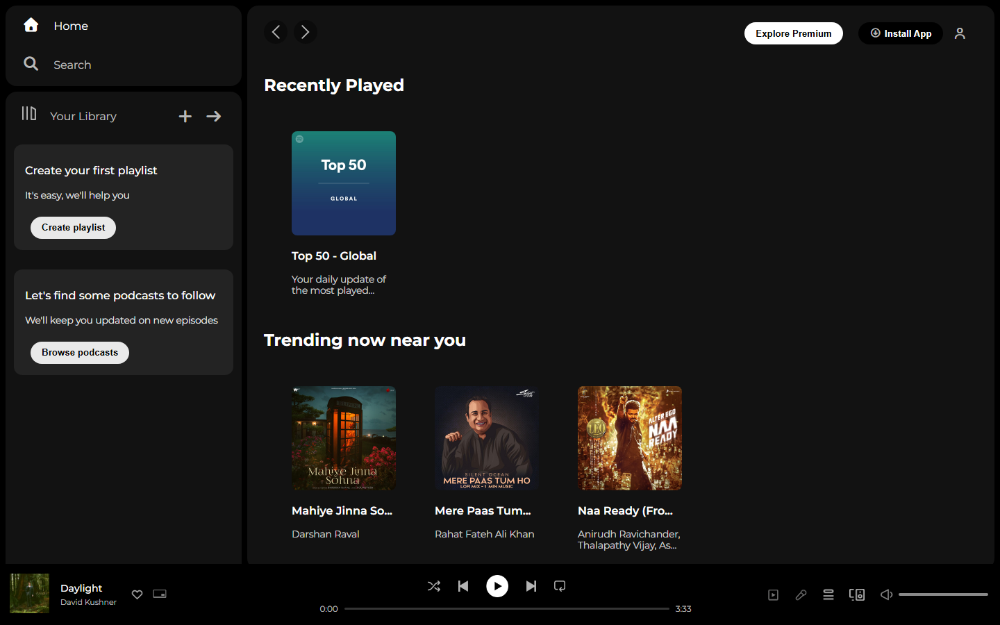

# 🎵 Spotify Homepage Clone

A **Spotify web player homepage clone** built with **HTML & CSS**. It recreates the signature dark layout — sidebar navigation, music cards, sticky top bar, and a fixed bottom player — as a pixel-close, static front-end.



## ✨ Features

- 🖤 Spotify-inspired dark theme with rounded panels
- 🧭 Sidebar with **Home**, **Search**, and **Your Library**
- 📚 Promo cards for creating playlists and browsing podcasts
- 🗂️ Content sections: **Recently Played**, **Trending now near you**, and **Featured Charts**
- 📌 Sticky top navigation with back/forward, *Explore Premium*, and *Install App*
- 🎧 Fixed bottom music player with album art, song info, playback controls, progress bar, and volume slider
- 🖱️ Hover states on cards, links, buttons, and controls
- 📐 Responsive tweaks — some nav items hide on narrow screens
- 🖌️ Custom scrollbar styling for the main content area

> 💡 This is a **UI clone only** — buttons, links, and sliders are styled but not connected to real playback.

## 🕹️ How to Use

| Action | Control |
| ------ | ------- |
| Explore sections | Scroll the main content area |
| Hover a card | Highlights the card and underlines labels |
| Navigation / player buttons | Visual only (`#` placeholder links) |

## 🚀 How to Run

No build step or installation needed.

```bash
cd "Spotify Homepage Clone"
# open index.html in your browser
```

Or serve it locally:

```bash
python -m http.server 8000
```

Then visit `http://localhost:8000/Spotify%20Homepage%20Clone/`.

> 🌐 An internet connection is needed for the Montserrat font and Font Awesome icons loaded from CDNs.

## 📁 Project Structure

```text
Spotify Homepage Clone/
├── index.html
├── style.css
└── Assets/   # logos, icons, album art, and card images
```

## 🧰 Tech Stack

- 🧱 HTML5
- 🎨 CSS3 (Flexbox, sticky positioning, custom scrollbars, media queries)
- 🔤 Google Fonts — Montserrat
- ⭐ Font Awesome 7 (CDN)
